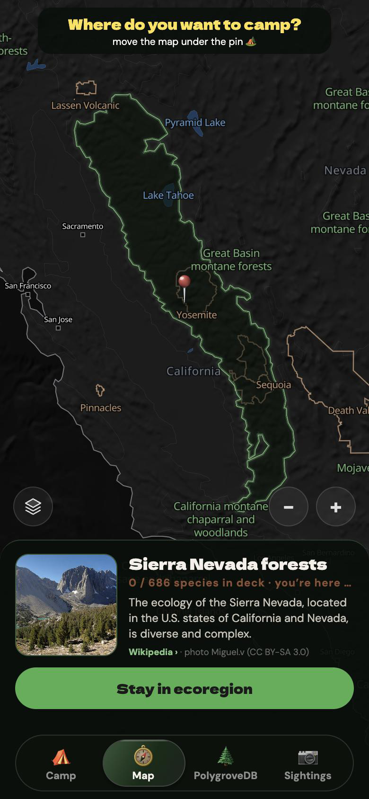
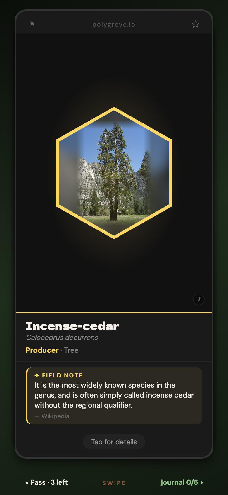
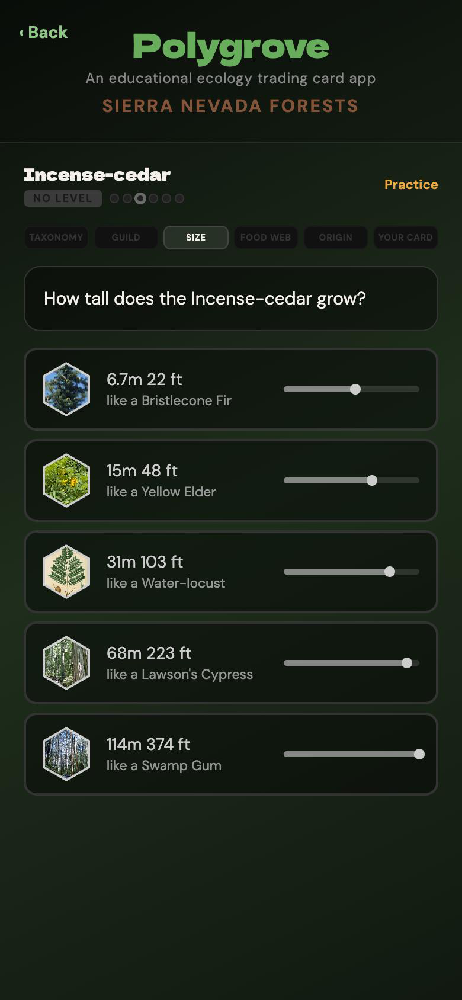

# Polygrove

**An educational ecology trading card game.** Pick a place on a world map of 847
ecoregions, open packs of real species that live there, and master each card
through a six-question quiz about how it fits into its ecosystem.

**Try it in your browser:** https://polygroveapp.com
· The species database behind it: https://polygrovedb.org
· Data pipeline: [polygrovedb](https://github.com/polygroveapp/polygrovedb)

<p>
  
  
  
</p>

## What it does

- **Camp anywhere on Earth.** A MapLibre map of the RESOLVE 2017 ecoregions. Drop
  the pin and that ecoregion becomes your deck: 14,911 species cards drawn from
  the places they actually occur.
- **Open packs.** Five cards at a time, weighted toward species that are commonly
  recorded nearby. Every card carries a Wikipedia photo, a field note, its size,
  its feeding role and a food web built from recorded interactions.
- **Master cards with the Solar Quiz.** Six questions per species, from taxonomy
  and feeding guild to size, food web, habitat and "which card is yours?".
  Wrong answers stay the same on a retry, so the quiz can't be beaten by
  elimination. The last question uses a second photo of the species, so it can't
  be answered by remembering the picture.
- **Turn real sightings into cards.** Link an iNaturalist account and every
  community-confirmed observation of an in-game species becomes a custom card,
  journaled in the ecoregion where you saw it.
- **Works offline on the trail.** A rolling queue of 100 cards per ecoregion and a
  snapshot of every collected card, photos included, are kept on the phone.

## Built with

| | |
|---|---|
| App | Expo SDK 57, React Native 0.86, TypeScript, Expo Router |
| Animation and gestures | Reanimated 4, Gesture Handler |
| Map | MapLibre GL JS in a WebView on phones and an iframe on the web, with a typed message bridge |
| Platforms | iOS (TestFlight via EAS Build), Android, and the web from the same code |
| Data | Static JSON from the [PolygroveDB](https://github.com/polygroveapp/polygrovedb) pipeline, served by Cloudflare Pages |

Privacy by design: the app never asks for your location and sends nothing about
you or your chosen place to a server. Your collection lives on your phone.

## Project layout

```
src/app/         screens (Expo Router): map, camp, pack, journal, quiz, PolygroveDB, sightings
src/components/  cards, honeycomb journal, map overlay, food-web graph, quiz button, WebFrame bridge
src/lib/         catalog loading, quiz builder, mastery, offline queue, iNaturalist sync
scripts/         deploy-app-site.sh: exports the web build and publishes it to polygroveapp.com
```

## Running it

```bash
npm install
npx expo start
```

Scan the QR code with Expo Go, or press `i` for the iOS simulator or `w` for the
web. Type-check and lint with `npx tsc --noEmit` and `npx expo lint`.

## Data and licences

Species facts come from open scientific trait databases, GBIF occurrence
records, GloBI interactions and Wikipedia. Photos are Wikipedia/Commons images or
iNaturalist photos under CC0, CC BY or CC BY-SA only, each credited on the card.
Full sources and licences are listed in the
[PolygroveDB repo](https://github.com/polygroveapp/polygrovedb).
